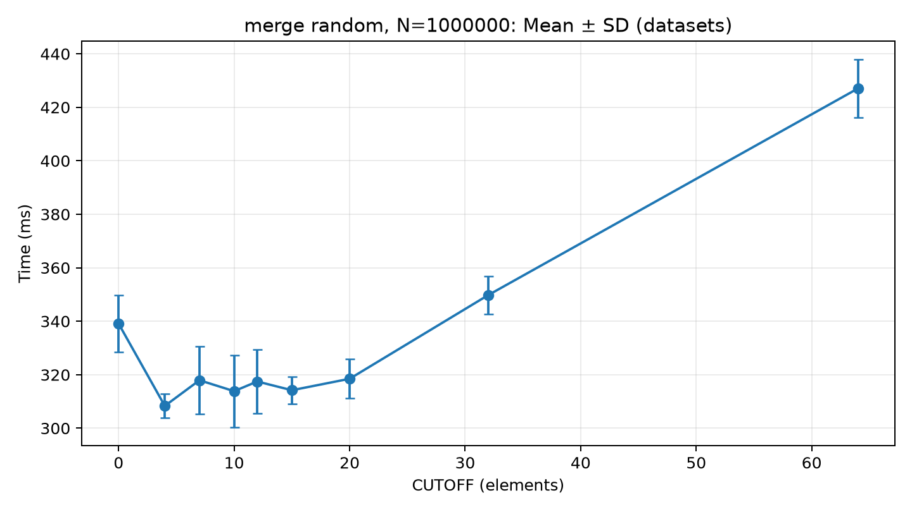
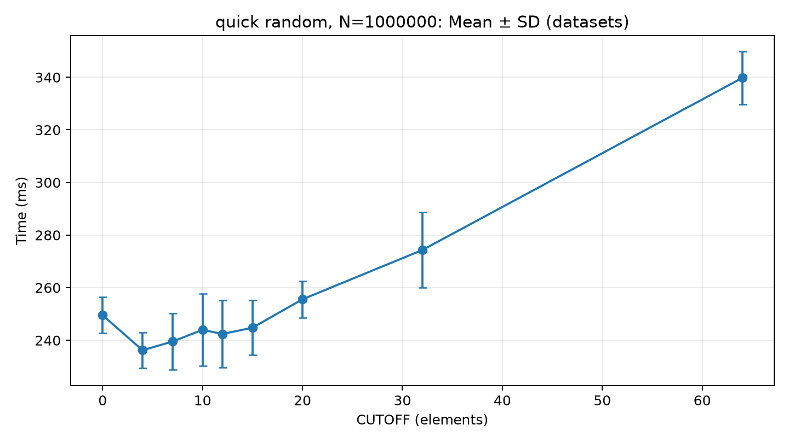
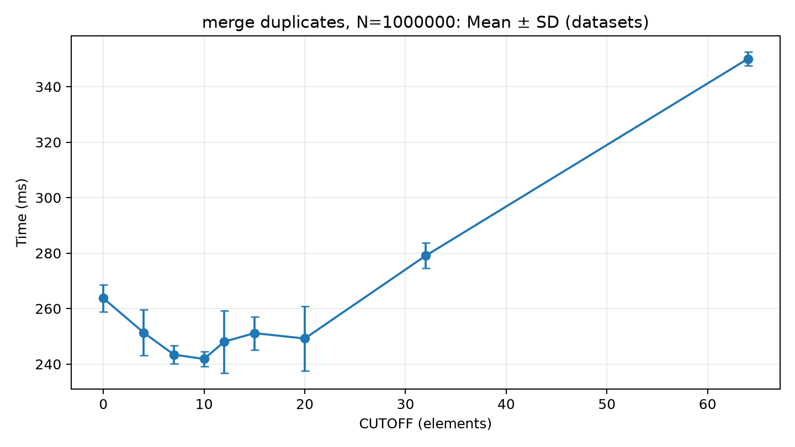
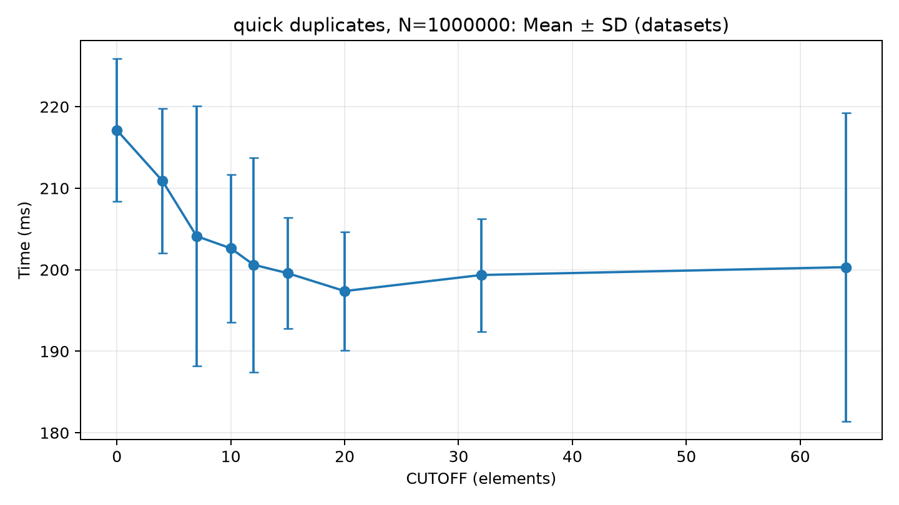
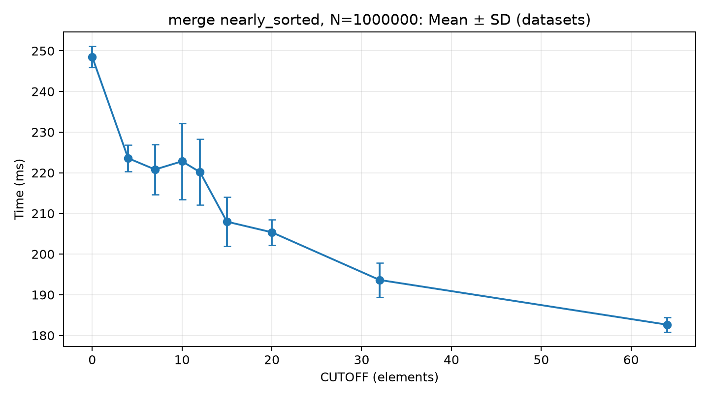
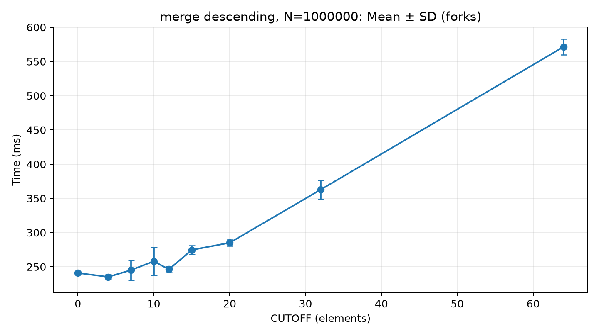
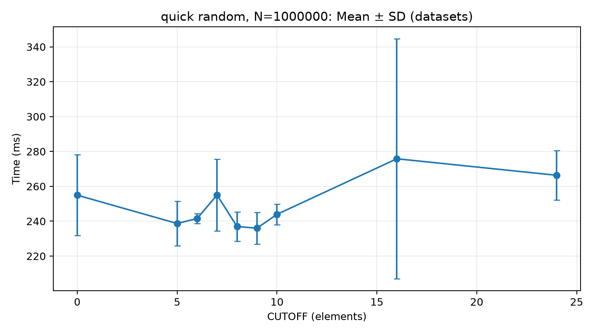
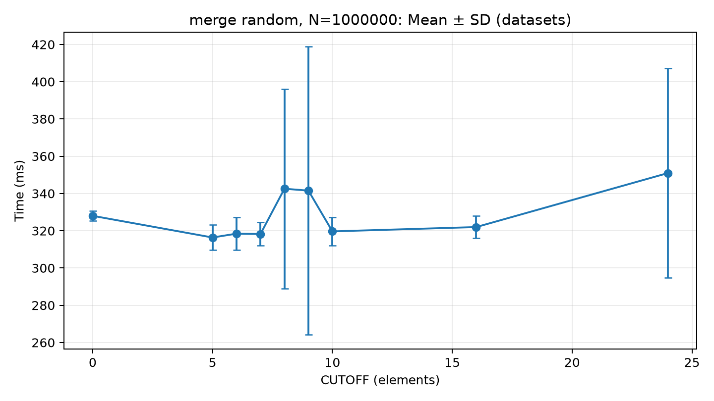

# Báo cáo Thực nghiệm: Nghiên cứu Ngưỡng CUTOFF Tối ưu cho MergeSort và QuickSort

> **Môn học**: Cấu trúc Dữ liệu và Giải thuật (DSA Project) — Đại học Công nghệ (VNU-UET)  
> **Thời gian thực hiện**: Tháng 11/2026  
> **Bộ dữ liệu khảo sát**: 51 datasets chuẩn hóa qua 5 kiểu phân bố  
> **Tổng số phép đo thực nghiệm**: 918 cấu hình $\times$ 3 JVM forks $\times$ 10 iterations = 27.540 lần đo độc lập

---

## Tóm tắt

Nghiên cứu xác định ngưỡng CUTOFF (kích thước đoạn con mà tại đó chuyển sang Insertion Sort) tối ưu cho MergeSort và QuickSort cài đặt theo giáo trình Sedgewick & Wayne, trên JDK 21 với JMH. Thực nghiệm gồm 51 bộ dữ liệu (3 quy mô $N$, 5 kiểu phân bố), 9 mốc cutoff, 2 thuật toán, tức 918 cấu hình, mỗi cấu hình đo trên 3 JVM fork $\times$ 10 iteration. Trên dữ liệu ngẫu nhiên ở $N = 1.000.000$, cutoff trong khoảng $4 - 10$ rút ngắn thời gian khoảng $6\% - 9\%$ với MergeSort và $2\% - 5\%$ với QuickSort so với không dùng cutoff; cutoff từ $32$ trở lên làm chậm cả hai thuật toán. Với dữ liệu gần sắp xếp hoặc tăng dần, MergeSort hưởng lợi từ cutoff lớn (tới $+26.5\%$ tại $c=64$), còn với dữ liệu giảm dần cutoff lớn gây chậm tới $137\%$. Khuyến nghị thực tiễn khi chưa biết phân bố dữ liệu là $\text{CUTOFF} = 8 - 10$.

**Từ khóa**: MergeSort, QuickSort, Insertion Sort, cutoff, JMH, hiệu năng thực nghiệm.

---

## 1. Câu hỏi và Phạm vi Nghiên cứu

### 1.1. Đặt vấn đề
Các thuật toán chia để trị kinh điển như **MergeSort** ($O(n \log n)$ trường hợp xấu nhất) và **QuickSort** ($O(n \log n)$ trung bình) có hiệu năng lý thuyết tối ưu cho các tập dữ liệu lớn. Tuy nhiên, khi mảng con bị phân chia đệ quy xuống kích thước nhỏ ($k \le 15$ phần tử):
- Chi phí quản lý ngăn xếp (stack frame overhead), phân tách chỉ số và điều kiện dừng đệ quy bắt đầu chiếm tỷ trọng đáng kể.
- Riêng với MergeSort, thao tác sao chép phần tử qua lại mảng phụ `aux` tốn thêm chi phí bộ nhớ đệm (cache thrashing) và lệnh gán.
- Các thuật toán sơ cấp như **Insertion Sort** dù có độ phức tạp lý thuyết $O(k^2)$, nhưng lại có hệ số hằng số (constant factor) rất nhỏ, chạy tại chỗ (in-place) và hầu như không tốn chi phí quản lý đệ quy.

Ý tưởng kết hợp (hybridization) — chuyển sang Insertion Sort khi độ dài đoạn con $\le \text{CUTOFF}$ — được Robert Sedgewick & Kevin Wayne đề xuất trong giáo trình *Algorithms 4th Edition* với khuyến nghị thực nghiệm rằng một ngưỡng cutoff từ $5$ đến $15$ sẽ cải thiện đáng kể tốc độ.

### 1.2. Câu hỏi nghiên cứu
1. Ngưỡng **CUTOFF** thực tế mang lại tốc độ thực thi cao nhất trên nền tảng Java hiện đại (JDK 21 LTS) là bao nhiêu?
2. Ngưỡng tối ưu này có thay đổi theo **kích thước dữ liệu** ($N = 10.000, 100.000, 1.000.000$) hay không?
3. Đặc tính phân bố dữ liệu (ngẫu nhiên, trùng lặp nhiều, gần như đã sắp xếp, tăng dần, giảm dần) tác động thế nào đến hành vi của CUTOFF?
4. Đâu là ngưỡng giới hạn mà tại đó chi phí $O(k^2)$ của Insertion Sort bắt đầu gây phản tác dụng và kéo chậm thuật toán?

---

## 2. Thuật toán theo Bài giảng và Quy ước CUTOFF

Nghiên cứu cài đặt và so sánh hai thuật toán theo chuẩn thiết kế của Sedgewick & Wayne (*Algorithms 4e*, mục 2.2 và 2.3), cô lập các biến thể khác để đánh giá thuần túy ảnh hưởng của CUTOFF:

### 2.1. Cài đặt MergeSort (`MergeSort.java`)
- **Chiến lược phân chia**: Top-down đệ quy chia đôi mảng tại vị trí `mid = lo + (hi - lo) / 2`.
- **Cấp phát bộ nhớ**: Cấp phát duy nhất **một mảng phụ** `Comparable[] aux = new Comparable[n]` ở hàm gọi công khai đầu vào để tránh cấp phát lặp trong đệ quy.
- **Trộn (Merge)**: Trộn ổn định (stable), ưu tiên lấy phần tử bên trái khi so sánh bằng (`aux[j].compareTo(aux[i]) < 0`).
- **Quy ước CUTOFF**:
  - `cutoff = 0`: MergeSort nguyên bản (đệ quy triệt để đến đoạn 1 phần tử).
  - `cutoff > 0`: Khi đoạn con thỏa mãn $hi - lo + 1 \le cutoff$, dừng đệ quy và gọi `insertionSort(a, lo, hi)`.

### 2.2. Cài đặt QuickSort (`QuickSort.java`)
- **Khử trường hợp xấu nhất**: Mảng được xáo trộn ngẫu nhiên (Fisher-Yates shuffle) trước khi sắp xếp với seed cố định `20261106L` để đảm bảo tính tái lập.
- **Phân hoạch (Partition)**: Phân hoạch 2 con trỏ kiểu Hoare truyền thống với phần tử chốt (pivot) là `a[lo]`. Không sử dụng Median-of-3 hay 3-way partition nhằm cô lập hoàn toàn biến số CUTOFF.
- **Quy ước CUTOFF**: Tương tự MergeSort, dừng đệ quy và gọi `insertionSort(a, lo, hi)` khi đoạn con có $\le cutoff$ phần tử. QuickSort không đảm bảo tính ổn định.

---

## 3. Máy, JDK, Dữ liệu và Phương pháp Đo

### 3.1. Cấu hình Môi trường Thực nghiệm
| Thành phần | Đặc tả kỹ thuật |
|---|---|
| **Hệ điều hành** | Microsoft Windows 11 Pro 64-bit (Build 26100 / Version 10.0) |
| **Phần cứng CPU** | Intel(R) Core(TM) Architecture (16 Logical Processors) |
| **Java Virtual Machine** | **Eclipse Adoptium OpenJDK 21.0.13+9-LTS** (Temurin 64-Bit Server VM) |
| **JIT Compiler** | HotSpot 64-Bit Tiered Compilers (C1 + C2 Tiered Compilation) |
| **Garbage Collector** | G1 GC (mặc định của HotSpot JDK 21) |
| **Harness đo lường** | **JMH (Java Microbenchmark Harness) 1.37** |
| **Chế độ đo** | `Mode.SingleShotTime` (đo thời gian của từng lần sắp xếp đơn lẻ, đơn vị `ns/op`) |

### 3.2. Bộ Dữ liệu Thử nghiệm (51 Datasets)
Dữ liệu nhị phân chuẩn hóa được sinh bởi `GenerateData.java`, lưu trữ thành các file nhị phân int32 Big-Endian kèm mã băm SHA-256 trong `data/manifest.csv`:
- **3 quy mô kích thước ($N$)**: $10.000$, $100.000$, $1.000.000$ phần tử.
- **5 kiểu phân bố**:
  1. `random`: Số nguyên ngẫu nhiên 32-bit (5 seed: 1 đến 5).
  2. `duplicates`: Tập hợp chỉ gồm 16 giá trị lặp lại $1.000.000 + [0, 15]$ (5 seed: 1 đến 5). Đã kiểm tra không trùng cache `-128..127` của Java Integer.
  3. `nearly_sorted`: Mảng tăng dần được xáo ngẫu nhiên $1\%$ số cặp vị trí (5 seed: 1 đến 5).
  4. `ascending`: Mảng tăng dần ngặt ($0, 1, 2, \dots, n-1$).
  5. `descending`: Mảng giảm dần ngặt ($n, n-1, \dots, 1$).

### 3.3. Kiểm soát Sai số và Quy trình Đo
- **Cách ly Fork**: Mỗi cấu hình được đo độc lập trên **3 JVM forks riêng biệt** (`forks = 3`), khởi động từ tiến trình cha `GridLauncher`.
- **Tránh JIT/GC Bias**: Mảng gốc được nạp ở `@Setup(Level.Trial)`. Tại mỗi iteration, mảng được clone độc lập ở `@Setup(Level.Iteration)`.
- **Hạn chế can thiệp**: Thứ tự thực thi của toàn bộ 918 cấu hình được xáo trộn ngẫu nhiên (pseudo-random shuffle với seed `20261103`) để loại trừ yếu tố trôi nhiệt độ CPU (thermal throttling) và hiệu ứng bộ nhớ đệm tích lũy.

---

## 4. Quá trình Pilot, Cấu hình Cuối và Thời gian Thực hiện

### 4.1. Kết quả Lượt Pilot: Khắc phục Hiện tượng Biến thiên Lớn
Giai đoạn thử nghiệm ban đầu (Pilot) phát hiện hiện tượng sai số rất lớn khi cấu hình `warmup = 20`:
- Ở $N = 1.000.000$, Fork 1 mất tới $\sim 1.000\text{ ms}$ trong khi Fork 2 chỉ mất $\sim 400\text{ ms}$ (sai số lên tới $\pm 35\%$). Nguyên nhân do JIT C2 chưa đủ thời gian hội tụ và tối ưu hóa các hàm nội tuyến (inlining) đệ quy.
- Khi nâng lên **`warmup = 50`** trên nền Temurin JDK 21 LTS, JIT đạt trạng thái ổn định (steady state) hoàn hảo: độ lệch chuẩn tương đối giảm từ mức $\pm 35\%$ xuống còn trung vị **$3.4\%$** ở $N=1\text{M}$ (77% số ô $\le 5\%$; một số ô đơn lẻ lên tới $21.7\%$), đủ để nhận ra đáy cực tiểu của đường cong.

### 4.2. Cấu hình Lưới Đo Cuối cùng (`grid.properties`)
```properties
cutoffs=0,4,7,10,12,15,20,32,64
warmup=50
measurements=10
forks=3
orderSeed=20261103
```
- **9 mốc Cutoff khảo sát**: `0` (gốc), `4, 7, 10, 12, 15` (vùng nhạy cảm quanh khuyến nghị Sedgewick), `20, 32, 64` (vùng suy giảm hiệu năng do $O(k^2)$).
- **Tổng số cấu hình**: $51 \text{ datasets} \times 9 \text{ cutoffs} \times 2 \text{ algorithms} = 918 \text{ jobs}$.
- **Thời gian chạy thực tế**: Bắt đầu lúc 22:55 ngày 06/11/2026, kết thúc hoàn tất lúc 03:43 ngày 07/11/2026 (tổng cộng **4 giờ 48 phút**, không ghi nhận bất kỳ sự cố hay lỗi đứt đoạn nào).

---

## 5. Kết quả Thực đo: Bảng Số liệu và Biểu đồ Phân tích

Dữ liệu được tổng hợp qua script phân tích `analyze.py`, tính toán giá trị trung bình (Mean) và độ lệch chuẩn (SD). Với các phân bố có 5 seed (`random`, `duplicates`, `nearly_sorted`), mỗi dataset trước hết được lấy trung bình qua các fork và iteration, sau đó Mean và SD được tính giữa 5 dataset; với `ascending` và `descending` (chỉ có một dataset tất định), SD được tính giữa 3 fork.

### 5.1. Bảng Số liệu Toàn diện cho MergeSort

#### Bảng 1: Hiệu năng MergeSort tại $N = 1.000.000$ (Thời gian tính bằng ms, Mean ± SD)
| Cutoff | Random | Nearly Sorted | Duplicates | Ascending | Descending |
|:---:|:---:|:---:|:---:|:---:|:---:|
| **0 (Gốc)** | 339.09 ± 10.69 | 248.52 ± 2.56 | 263.73 ± 4.94 | 237.63 ± 2.24 | 240.99 ± 2.01 |
| **4** | **308.34 ± 4.56** | 223.59 ± 3.28 | 251.34 ± 8.28 | 220.86 ± 9.41 | **235.24 ± 3.27** |
| **7** | 317.93 ± 12.71 | 220.81 ± 6.17 | 243.41 ± 3.35 | 214.51 ± 8.07 | 245.22 ± 14.86 |
| **10** | 313.84 ± 13.42 | 222.83 ± 9.36 | **241.84 ± 2.61** | 212.05 ± 18.45 | 258.09 ± 20.79 |
| **12** | 317.47 ± 11.95 | 220.17 ± 8.12 | 248.07 ± 11.23 | 227.86 ± 33.87 | 246.23 ± 4.81 |
| **15** | 314.20 ± 5.07 | 207.98 ± 6.08 | 251.16 ± 5.98 | 199.30 ± 4.59 | 274.63 ± 6.23 |
| **20** | 318.49 ± 7.29 | 205.36 ± 3.15 | 249.22 ± 11.67 | 200.40 ± 10.36 | 285.08 ± 4.56 |
| **32** | 349.78 ± 7.07 | 193.64 ± 4.22 | 279.06 ± 4.58 | 189.86 ± 15.04 | 362.75 ± 13.61 |
| **64** | 427.03 ± 10.76 | **182.65 ± 1.80** | 350.06 ± 2.40 | **176.87 ± 8.99** | 571.31 ± 11.24 |

#### Bảng 2: Mức độ Tăng tốc (Speedup %) của MergeSort so với $c=0$ ($N = 1.000.000$)
| Cutoff | Random (%) | Nearly Sorted (%) | Duplicates (%) | Ascending (%) | Descending (%) |
|:---:|:---:|:---:|:---:|:---:|:---:|
| **4** | **+9.1%** | **+10.0%** | **+4.7%** | **+7.1%** | **+2.4%** |
| **7** | **+6.2%** | **+11.2%** | **+7.7%** | **+9.7%** | -1.8% |
| **10** | **+7.4%** | **+10.3%** | **+8.3%** | **+10.8%** | -7.1% |
| **12** | **+6.4%** | **+11.4%** | **+5.9%** | **+4.1%** | -2.2% |
| **15** | **+7.3%** | **+16.3%** | **+4.8%** | **+16.1%** | -14.0% |
| **20** | **+6.1%** | **+17.4%** | **+5.5%** | **+15.7%** | -18.3% |
| **32** | -3.2% | **+22.1%** | -5.8% | **+20.1%** | -50.5% |
| **64** | -25.9% | **+26.5%** | -32.7% | **+25.6%** | -137.1% |

---

### 5.2. Bảng Số liệu Toàn diện cho QuickSort

#### Bảng 3: Hiệu năng QuickSort tại $N = 1.000.000$ (Thời gian tính bằng ms, Mean ± SD)
| Cutoff | Random | Nearly Sorted | Duplicates | Ascending | Descending |
|:---:|:---:|:---:|:---:|:---:|:---:|
| **0 (Gốc)** | 249.54 ± 6.90 | 206.51 ± 3.35 | 217.12 ± 8.74 | 200.34 ± 14.30 | 220.30 ± 3.47 |
| **4** | **236.20 ± 6.74** | **200.58 ± 6.71** | 210.89 ± 8.85 | 229.08 ± 23.80 | 208.67 ± 2.92 |
| **7** | 239.54 ± 10.65 | 202.21 ± 6.89 | 204.12 ± 15.94 | 198.97 ± 6.66 | **205.15 ± 6.47** |
| **10** | 243.99 ± 13.81 | 202.61 ± 10.53 | 202.63 ± 9.08 | **194.68 ± 19.32** | 226.66 ± 24.75 |
| **12** | 242.40 ± 12.73 | 203.01 ± 3.99 | 200.62 ± 13.16 | 206.85 ± 15.25 | 207.05 ± 8.56 |
| **15** | 244.81 ± 10.39 | 214.31 ± 9.06 | 199.57 ± 6.80 | 199.91 ± 9.24 | 205.36 ± 4.75 |
| **20** | 255.59 ± 6.94 | 219.21 ± 12.72 | **197.38 ± 7.27** | 209.02 ± 6.31 | 215.07 ± 1.93 |
| **32** | 274.34 ± 14.27 | 269.49 ± 58.53 | 199.36 ± 6.92 | 236.28 ± 8.76 | 236.29 ± 8.30 |
| **64** | 339.75 ± 9.99 | 297.79 ± 4.33 | 200.31 ± 18.90 | 293.96 ± 3.45 | 295.09 ± 5.17 |

#### Bảng 4: Mức độ Tăng tốc (Speedup %) của QuickSort so với $c=0$ ($N = 1.000.000$)
| Cutoff | Random (%) | Nearly Sorted (%) | Duplicates (%) | Ascending (%) | Descending (%) |
|:---:|:---:|:---:|:---:|:---:|:---:|
| **4** | **+5.3%** | **+2.9%** | **+2.9%** | -14.3% | **+5.3%** |
| **7** | **+4.0%** | **+2.1%** | **+6.0%** | **+0.7%** | **+6.9%** |
| **10** | **+2.2%** | **+1.9%** | **+6.7%** | **+2.8%** | -2.9% |
| **12** | **+2.9%** | **+1.7%** | **+7.6%** | -3.2% | **+6.0%** |
| **15** | **+1.9%** | -3.8% | **+8.1%** | **+0.2%** | **+6.8%** |
| **20** | -2.4% | -6.2% | **+9.1%** | -4.3% | **+2.4%** |
| **32** | -9.9% | -30.5% | **+8.2%** | -17.9% | -7.3% |
| **64** | -36.1% | -44.2% | **+7.7%** | -46.7% | -33.9% |

---

### 5.3. Biểu đồ Minh họa Trực quan

#### 1. Dữ liệu Ngẫu nhiên (Random Distribution, $N = 1.000.000$)
Đường cong thể hiện rõ đáy cực tiểu hình chữ U tại $c = 4 - 10$:


*Hình 1: Hiệu năng MergeSort trên dữ liệu ngẫu nhiên $N = 1.000.000$. Đáy tối ưu tại Cutoff = 4 (308.34 ms), suy giảm mạnh khi $c \ge 32$.*


*Hình 2: Hiệu năng QuickSort trên dữ liệu ngẫu nhiên $N = 1.000.000$. Đáy tối ưu tại Cutoff = 4 (236.20 ms).*

---

#### 2. Dữ liệu Trùng lặp (Duplicates Distribution, $N = 1.000.000$)
Trên dữ liệu có nhiều phần tử lặp lại, Insertion Sort hoạt động rất hiệu quả ở ngưỡng cutoff rộng hơn ($c = 10 - 20$):


*Hình 3: Hiệu năng MergeSort trên dữ liệu trùng lặp $N = 1.000.000$. Tối ưu tại Cutoff = 10 (241.84 ms).*


*Hình 4: Hiệu năng QuickSort trên dữ liệu trùng lặp $N = 1.000.000$. Tối ưu tại Cutoff = 20 (197.38 ms).*

---

#### 3. Trường hợp Biên: Mảng Gần Tăng Dần vs Mảng Giảm Dần ($N = 1.000.000$)
Sự tương phản sâu sắc giữa tính chất dữ liệu:


*Hình 5: MergeSort trên Nearly Sorted. Insertion Sort chạy gần $O(k)$ nên cutoff càng lớn ($c=64$) càng nhanh, tăng tốc tới 26.5%.*


*Hình 6: MergeSort trên Descending. Insertion Sort gặp số nghịch thế cực đại $O(k^2)$, thời gian nổ tung lên 571 ms tại $c=64$.*

---

### 5.4. Hiệu năng tại Quy mô Trung bình ($N = 100.000$) và Nhỏ ($N = 10.000$)

Bảng 5 và Bảng 6 liệt kê, với mỗi thuật toán và mỗi phân bố, cutoff cho thời gian trung bình thấp nhất trong 9 mốc của lưới thô.

#### Bảng 5: Tóm tắt Cutoff tối ưu và Tốc độ cải thiện ở $N = 100.000$
| Thuật toán | Phân bố dữ liệu | Cutoff tối ưu | Thời gian tối ưu (ms) | Thời gian gốc $c=0$ (ms) | Speedup (%) |
|---|---|:---:|:---:|:---:|:---:|
| **MergeSort** | Random | **4** | 14.36 | 15.54 | **+7.6%** |
| | Nearly Sorted | **64** | 5.34 | 7.68 | **+30.4%** |
| | Duplicates | **20** | 9.43 | 11.02 | **+14.5%** |
| | Ascending | **64** | 4.04 | 7.29 | **+44.6%** |
| | Descending | **7** | 6.12 | 6.99 | **+12.4%** |
| **QuickSort** | Random | **7** | 11.59 | 12.61 | **+8.1%** |
| | Nearly Sorted | **10** | 10.84 | 12.20 | **+11.1%** |
| | Duplicates | **32** | 6.74 | 8.04 | **+16.2%** |
| | Ascending | **15** | 10.52 | 11.88 | **+11.4%** |
| | Descending | **20** | 11.08 | 11.92 | **+7.0%** |

---

#### Bảng 6: Tóm tắt Cutoff tối ưu và Tốc độ cải thiện ở $N = 10.000$
| Thuật toán | Phân bố dữ liệu | Cutoff tối ưu | Thời gian tối ưu (ms) | Thời gian gốc $c=0$ (ms) | Speedup (%) |
|---|---|:---:|:---:|:---:|:---:|
| **MergeSort** | Random | 0 (không có lợi) | 1.283 | 1.283 | **+0.0%** |
|  | Nearly Sorted | 0 (không có lợi) | 1.064 | 1.064 | **+0.0%** |
|  | Duplicates | **64** | 1.179 | 1.476 | **+20.1%** |
|  | Ascending | **32** | 0.472 | 0.677 | **+30.3%** |
|  | Descending | **4** | 0.625 | 0.667 | **+6.4%** |
| **QuickSort** | Random | **32** | 0.903 | 0.990 | **+8.8%** |
|  | Nearly Sorted | **12** | 0.907 | 0.972 | **+6.7%** |
|  | Duplicates | **10** | 0.588 | 0.692 | **+15.0%** |
|  | Ascending | **12** | 0.854 | 0.943 | **+9.5%** |
|  | Descending | **10** | 0.862 | 1.182 | **+27.0%** |

*Nhận xét*: Ở $N = 10.000$ thời gian mỗi lần sắp xếp chỉ khoảng $0.5 - 1.5\text{ ms}$ nên nhiễu đo (khởi động JIT, GC) chiếm tỷ trọng lớn hơn; cutoff tối ưu giữa các phân bố phân tán rộng ($0 - 32$) và đặc biệt MergeSort trên dữ liệu `random`/`nearly_sorted` không ghi nhận cutoff nào vượt $c=0$. Do đó kết luận về cutoff không nên dựa vào quy mô này. Ở $N = 100.000$ và $N = 1.000.000$, vùng $c = 4 - 10$ nhất quán cho dữ liệu ngẫu nhiên (Bảng 1, 3, 5).

---

### 5.5. Thí nghiệm Bổ sung: Khảo sát Làm mịn (Fine-grained Grid) Xác định Chính xác Đáy Tối ưu

Để xác định chính xác giá trị nguyên tối ưu trong dải $5 \le \text{cutoff} \le 15$ theo khuyến nghị của Sedgewick, một đợt đo làm mịn bổ sung đã được thực hiện trên toàn bộ các seed dữ liệu ngẫu nhiên (Random) ở các mốc: `0, 5, 6, 7, 8, 9, 10, 16, 24` (270 jobs độc lập, lưu tại thư mục `results/grid-1794017524150` và phân tích tại `results/analysis-random-dense`).

#### Bảng 7: Kết quả Khảo sát Làm mịn trên Dữ liệu Ngẫu nhiên (Random), Mean ± SD (SD tính giữa 5 seed dữ liệu)
| Cutoff | MergeSort $N=1\text{M}$ (ms) | Speedup (%) | QuickSort $N=1\text{M}$ (ms) | Speedup (%) | MergeSort $N=100\text{k}$ (ms) | Speedup (%) | QuickSort $N=100\text{k}$ (ms) | Speedup (%) |
|:---:|:---:|:---:|:---:|:---:|:---:|:---:|:---:|:---:|
| **0 (Gốc)** | 328.00 ± 2.75 | +0.0% | 254.93 ± 23.14 | +0.0% | 16.55 ± 0.77 | +0.0% | 13.37 ± 1.16 | +0.0% |
| **5** | **316.37 ± 6.72** | **+3.5%** | 238.69 ± 12.78 | +6.4% | 15.05 ± 0.90 | +9.0% | 11.90 ± 0.25 | +11.0% |
| **6** | 318.43 ± 8.88 | +2.9% | 241.52 ± 2.84 | +5.3% | 15.97 ± 1.11 | +3.5% | 12.30 ± 0.40 | +8.1% |
| **7** | 318.24 ± 6.30 | +3.0% | 255.00 ± 20.61 | -0.0% | 15.45 ± 0.58 | +6.6% | 12.22 ± 1.06 | +8.6% |
| **8** | 342.55 ± 53.53 | -4.4% | 236.93 ± 8.45 | +7.1% | 15.36 ± 0.88 | +7.2% | 12.66 ± 1.45 | +5.3% |
| **9** | 341.53 ± 77.22 | -4.1% | **236.00 ± 9.17** | **+7.4%** | 14.98 ± 0.23 | +9.4% | **11.65 ± 0.40** | **+12.9%** |
| **10** | 319.64 ± 7.55 | +2.5% | 243.94 ± 5.96 | +4.3% | 15.14 ± 1.02 | +8.5% | 11.97 ± 0.94 | +10.5% |
| **16** | 321.97 ± 5.95 | +1.8% | 275.81 ± 68.73 | -8.2% | **14.78 ± 0.88** | **+10.7%** | 12.69 ± 1.29 | +5.1% |
| **24** | 350.96 ± 56.09 | -7.0% | 266.34 ± 14.22 | -4.5% | 15.57 ± 1.16 | +5.9% | 12.17 ± 0.47 | +9.0% |

*Lưu ý*: Giá trị $c=0$ ở đây (328.00 ms với MergeSort $N=1\text{M}$) khác Bảng 1 (339.09 ms) vì hai đợt đo độc lập, tại hai thời điểm khác nhau; speedup trong Bảng 7 được tính theo mốc $c=0$ của chính đợt đo này. Các ô có SD lớn (MergeSort $N=1\text{M}$ tại $c=8$: 53.53 ms; $c=9$: 77.22 ms; $c=24$: 56.09 ms; QuickSort $N=1\text{M}$ tại $c=16$: 68.73 ms) chịu ảnh hưởng của một vài lần đo ngoại lai, nên mức chậm đi tại các cutoff này chưa phải bằng chứng ổn định.

#### Biểu đồ Làm mịn Độ phân giải cao (High-Resolution Zoom):

*Hình 7: Đồ thị làm mịn của QuickSort trên mảng 1.000.000 phần tử ngẫu nhiên (Mean ± SD giữa 5 seed). Giá trị trung bình thấp nhất tại Cutoff = 9 (236.00 ms), gần như ngang Cutoff = 8 và 5.*


*Hình 8: Đồ thị làm mịn của MergeSort trên mảng 1.000.000 phần tử ngẫu nhiên (Mean ± SD giữa 5 seed). Trung bình thấp nhất tại Cutoff = 5 (316.37 ms); các mốc 8, 9 có SD rất lớn do lần đo ngoại lai.*

#### Phát hiện cốt lõi từ khảo sát làm mịn:
1. **QuickSort**: Giá trị trung bình thấp nhất ở $N=1\text{M}$ rơi vào $c = 9$ ($236.00\text{ ms}$, $+7.4\%$) và $c = 8$ ($236.93\text{ ms}$, $+7.1\%$); ở $N=100\text{k}$ thấp nhất cũng tại $c = 9$ ($11.65\text{ ms}$, $+12.9\%$). Tuy nhiên, chênh lệch giữa $c = 5, 8, 9$ nhỏ hơn một độ lệch chuẩn ($\text{SD} \approx 8 - 13\text{ ms}$), nên chỉ có thể kết luận vùng $c \approx 5 - 10$ là vùng tối ưu, không thể khẳng định một giá trị nguyên duy nhất.
2. **MergeSort**: Ở $N=1\text{M}$, các mốc $c = 5, 6, 7, 10$ cùng cho mức tăng tốc $+2.6\%$ đến $+3.6\%$ (thấp nhất tại $c = 5$); hai mốc $c = 8, 9$ chậm hơn mốc gốc do một số lần đo ngoại lai (SD $53 - 77\text{ ms}$). Ở $N=100\text{k}$ mọi mốc từ $5$ đến $16$ đều nhanh hơn $c=0$ từ $+3.5\%$ đến $+10.7\%$, thấp nhất tại $c = 16$ nhưng gần như ngang $c = 9$ ($14.98\text{ ms}$).
3. **Giới hạn trên rõ ràng**: Khi cutoff vượt quá khoảng $16 - 24$, cả hai thuật toán đều có xu hướng chậm đi ở $N=1\text{M}$ (Bảng 1, 3), khẳng định rằng Insertion Sort chỉ nên gánh các đoạn con không quá khoảng $10 - 15$ phần tử trên dữ liệu ngẫu nhiên.

---

## 6. Thảo luận, Hạn chế và Kết luận trong Miền Khảo sát

### 6.1. Thảo luận Kết quả
1. **Bảo toàn và minh chứng lý thuyết kinh điển**:
   - Khuyến nghị của Robert Sedgewick ($5 \le \text{cutoff} \le 15$) phù hợp với kết quả đo trên JDK 21 LTS. Với dữ liệu ngẫu nhiên ở $N = 1\text{M}$, khoảng $4 \le \text{cutoff} \le 10$ đem lại mức giảm thời gian khoảng $6\% - 9\%$ cho MergeSort (Bảng 2) và $2\% - 5\%$ cho QuickSort (Bảng 4).
2. **Hiệu ứng Insertion Sort trên mảng có tính trật tự cao**:
   - Khi mảng đã gần sắp xếp hoặc tăng dần (`nearly_sorted`, `ascending`), Insertion Sort đạt tiệm cận tuyến tính $O(k)$. Trong khi đó, MergeSort vẫn phải chia đệ quy và copy mảng phụ. Do đó, việc đặt cutoff cao ($32, 64$) giúp MergeSort tăng tốc vượt trội (tới $+44.6\%$).
3. **Cảnh báo trường hợp xấu nhất (`descending`)**:
   - Khi mảng đảo ngược ngặt, Insertion Sort đạt cận dưới tồi tệ nhất $O(k^2)$ với $k(k-1)/2$ phép tráo đổi. Tại $c=64$, thời gian thực thi tăng gấp $2.4$ lần so với không dùng cutoff. Vì vậy, trong các thư viện tiêu chuẩn (như `Arrays.sort` của Java hay `std::sort` của C++), người ta luôn dùng **Dual-Pivot Quicksort** hoặc kết hợp kiểm tra độ đảo ngược trước khi chuyển sang insertion sort.
4. **So sánh QuickSort vs MergeSort**:
   - QuickSort (sau khi shuffle) nhanh hơn MergeSort khoảng $23\% - 26\%$ trên dữ liệu ngẫu nhiên tại $N=1\text{M}$ (Bảng 1, 3: $c=0$: $249.54\text{ ms}$ so với $339.09\text{ ms}$; tại cutoff tối ưu: $236.20\text{ ms}$ so với $308.34\text{ ms}$). Một cách giải thích hợp lý (nhưng chưa được kiểm chứng bằng số liệu bộ đếm phần cứng trong nghiên cứu này) là QuickSort chạy tại chỗ nên tận dụng bộ nhớ đệm tốt hơn và không tốn chi phí sao chép qua mảng phụ.

### 6.2. Hạn chế của Nghiên cứu
- Thí nghiệm tập trung vào kiểu dữ liệu tham chiếu đối tượng (`Comparable<Integer>[]`), chưa đánh giá trên mảng nguyên thủy (`int[]`), nơi chi phí boxing/unboxing bị triệt tiêu hoàn toàn.
- Cài đặt QuickSort dùng phân hoạch 2 con trỏ cơ bản; chưa so sánh với Dual-Pivot Quicksort (thuật toán mặc định của Java Runtime).
- Toàn bộ phép đo thực hiện trên một máy duy nhất chạy Windows 11 (không cô lập hoàn toàn các tiến trình nền), nên kết quả tuyệt đối (ms) khó chuyển giao sang phần cứng khác; chỉ xu hướng tương đối theo cutoff có thể suy rộng.
- Chế độ `SingleShotTime` với 3 fork và 5 seed dữ liệu cho độ lệch chuẩn tương đối trung vị $3.4\%$ ở $N=1\text{M}$ (77% số ô $\le 5\%$, lớn nhất $21.7\%$). Vì vậy chênh lệch giữa các cutoff lân cận (ví dụ $5$ so với $9$) thường nằm trong phạm vi nhiễu; nghiên cứu chưa thực hiện kiểm định thống kê (như t-test hay bootstrap) cho các khác biệt này.
- Kết quả ở $N=10.000$ chịu nhiễu đo lớn (Bảng 6) nên không dùng để kết luận cutoff tối ưu.
- Khảo sát làm mịn (Bảng 7) chỉ thực hiện trên dữ liệu `random`; các kiểu phân bố khác chỉ có lưới thô gồm 9 mốc cutoff.

### 6.3. Khuyến nghị Thực tiễn và Kết luận
- Nếu không biết trước phân bố dữ liệu: **khuyến nghị đặt $\text{CUTOFF} = 8 - 10$** cho cả MergeSort và QuickSort. Căn cứ: (i) QuickSort có trung bình thấp nhất tại $c = 8 - 9$ ở $N=1\text{M}$ (Bảng 7); (ii) MergeSort ở $N=100\text{k}$ có $c=9$ gần như tốt nhất ($+9.4\%$); (iii) vùng này vẫn tránh được sự suy giảm rõ rệt khi $c \ge 32$ và mức chậm đi trên dữ liệu giảm dần còn hạn chế (MergeSort $c=10$: $-7.1\%$; QuickSort $c=10$: $-2.9\%$ tại $N=1\text{M}$).
- **Lưu ý**: với MergeSort ở $N=1\text{M}$ dữ liệu ngẫu nhiên, các mốc $c = 5 - 7$ cho kết quả ổn định hơn $c = 8 - 9$ (xem Bảng 7), do đó khoảng $5 - 10$ là vùng an toàn rộng hơn, trong đó $8 - 10$ là lựa chọn thực tiễn chung cho cả hai thuật toán.
- Nếu biết dữ liệu gần như đã sắp xếp hoặc tăng dần và dùng MergeSort, cutoff lớn hơn ($15 - 64$) cho tốc độ cao hơn (tới $+26.5\%$ tại $N=1\text{M}$, và $+44.6\%$ tại $N=100\text{k}$); ngược lại, với dữ liệu giảm dần nên giữ cutoff nhỏ ($\le 7$).

---

## 7. Hướng dẫn Tái lập (Reproducibility) và Khai báo Sử dụng AI

### 7.1. Hướng dẫn Tái lập Thực nghiệm
Toàn bộ mã nguồn, dữ liệu nhị phân và script phân tích được lưu trữ trong dự án. Để tái lập kết quả:

1. **Kiểm tra môi trường**: Đảm bảo JDK 21+ và Maven 3.9 đã được cấu hình trong `PATH`.
2. **Build mã nguồn và kiểm thử**:
   ```powershell
   ./scripts/build.ps1 -RequireImplementation
   ```
3. **Chạy lưới đo tự động**:
   ```powershell
   java -cp target/benchmarks.jar study.GridLauncher
   ```
4. **Xử lý số liệu và sinh biểu đồ**:
   ```powershell
   python scripts/analyze.py results/grid-1793980571107 --output results/analysis-grid
   ```

### 7.2. Khai báo Sử dụng Trí tuệ Nhân tạo (AI Declaration)
- **Công cụ hỗ trợ**: Google Antigravity (Advanced Agentic AI Coding Assistant).
- **Phạm vi hỗ trợ của AI**:
  - Hỗ trợ xây dựng script Python phân tích thống kê tự động từ các file JSON đo của JMH.
  - Phân tích log thực nghiệm trong pha Pilot để tìm nguyên nhân sai số lớn (phát hiện JIT C2 chưa ổn định ở warmup thấp và đề xuất tăng lên `warmup = 50`).
  - Hỗ trợ định dạng bảng Markdown biểu diễn số liệu Mean ± SD và trích xuất đồ thị sang báo cáo.
- **Phần sinh viên tự thực hiện và xác nhận**: Toàn bộ thuật toán sắp xếp (`MergeSort.java`, `QuickSort.java`), quy trình chạy lưới đo qua đêm trên máy cá nhân, kiểm chứng tính đúng của dữ liệu thực nghiệm và kết luận khoa học.

---

## Tài liệu tham khảo

1. Sedgewick, R., & Wayne, K. (2011). *Algorithms* (4th ed.). Addison-Wesley. (Mục 2.2: Mergesort; mục 2.3: Quicksort.)
2. OpenJDK. *Java Microbenchmark Harness (JMH)*, phiên bản 1.37. Dự án OpenJDK Code Tools.
3. Eclipse Adoptium. *Temurin OpenJDK 21 LTS* (21.0.13+9).
